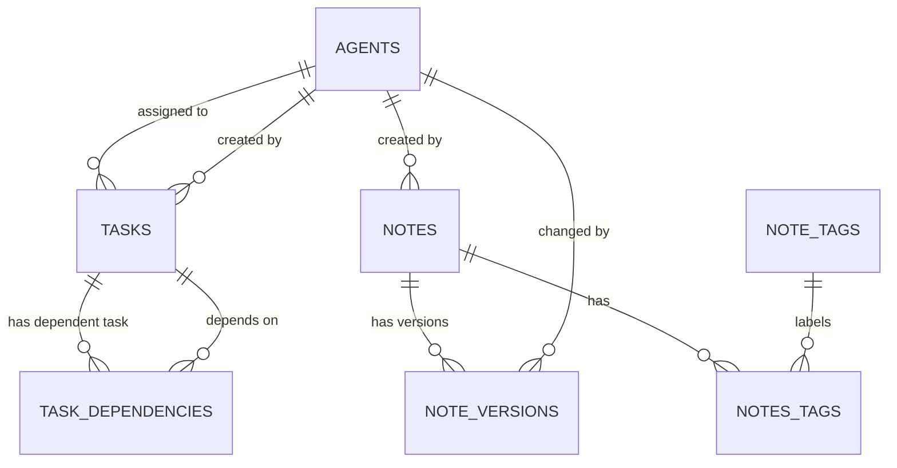

# ResearchMate — Database Design

**Document version:** 0.1  
**Status:** Initial Draft  
**Database:** PostgreSQL 18  
**Project name:** ResearchMate

---

## 1. Purpose

This document describes the proposed PostgreSQL database structure for ResearchMate.

It identifies the initial entities, their relationships, important fields, constraints, and indexing requirements. The design supports the Task Management, Notes Management, and Agent Information capabilities described in `PROJECT_REQUIREMENTS.md` and the MCP category specifications.

This is a logical and initial physical design. The implementation may refine field lengths, indexes, and migration details as requirements are finalized. Any material change should be recorded in `DECISIONS.md`.

## 2. Design Principles

1. Use relational tables for structured application data.
2. Use primary keys and foreign keys to maintain referential integrity.
3. Use PostgreSQL `TIMESTAMPTZ` for timestamps.
4. Store flexible agent capability metadata in `JSONB` where appropriate.
5. Use database constraints for valid task statuses and priorities.
6. Keep note version history separate from the current note record.
7. Represent task dependencies using a separate relationship table.
8. Do not store secrets, API keys, passwords, or database connection strings in application tables.
9. Treat the local workspace filesystem as the source of truth for file contents in the initial version.
10. Derive MCP resources and system statistics from the underlying records; do not create duplicate tables just to represent MCP resources.

## 3. Initial Entity Overview

The initial database design includes:

| Entity | Purpose |
|---|---|
| `agents` | Stores registered MAS agent information. |
| `tasks` | Stores tasks created by users or agents. |
| `task_dependencies` | Stores dependency relationships between tasks. |
| `notes` | Stores the current version and metadata of notes. |
| `note_versions` | Retains previous note content when a note is updated. |
| `note_tags` | Stores normalized note tags. |
| `notes_tags` | Associates notes with tags. |

A dedicated `users` table is not included in this initial draft because the first implementation's user-account and multi-user requirements have not yet been confirmed. The assignment design below therefore allows an optional human assignee identifier without enforcing a foreign key. This must be revisited before multi-user support is implemented.

## 4. Entity Definitions

### 4.1 `agents`

Stores the agents registered with ResearchMate.

| Column | PostgreSQL type | Constraints | Description |
|---|---|---|---|
| `agent_id` | UUID | Primary key | Unique agent identifier (DEC-026). |
| `name` | VARCHAR(100) | NOT NULL, UNIQUE | Agent name. |
| `code` | VARCHAR(50) | NULL, UNIQUE | Optional human-readable display code (e.g. `AGENT-001`). |
| `role` | VARCHAR(50) | NOT NULL | Agent role, such as `orchestrator`, `research`, or `task_management`. |
| `description` | TEXT | NULL | Description of the agent's purpose. |
| `model` | VARCHAR(100) | NULL | Model used by the agent. |
| `provider` | VARCHAR(50) | NULL | Model provider, such as Ollama or Google. |
| `status` | VARCHAR(20) | NOT NULL | Application-reported status. |
| `capabilities` | JSONB | NOT NULL, DEFAULT `[]` | Capabilities and accessible MCP operations. |
| `created_at` | TIMESTAMPTZ | NOT NULL | Record creation time. |
| `last_active_at` | TIMESTAMPTZ | NULL | Last activity time reported by the MAS. |

Suggested status values:
- `active`
- `inactive`
- `busy`
- `error`

The `agents` table represents application-level agent registration and status. It does not provide cryptographic agent identity, authentication, or authorization.

The MAS should be the source of truth for runtime status. A registered agent should not automatically be considered active.

### 4.2 `tasks`

Stores tasks managed by ResearchMate.

| Column | PostgreSQL type | Constraints | Description |
|---|---|---|---|
| `task_id` | UUID | Primary key | Unique task identifier. |
| `title` | VARCHAR(255) | NOT NULL | Short task title. |
| `description` | TEXT | NULL | Detailed task description. |
| `status` | VARCHAR(20) | NOT NULL, DEFAULT `pending` | Current task status. |
| `priority` | VARCHAR(20) | NOT NULL, DEFAULT `medium` | Task priority. |
| `assigned_agent_id` | UUID | Foreign key to `agents.agent_id`, NULL | Agent assigned to the task, if applicable. |
| `assigned_user_id` | UUID | NULL | Reserved for a future user-account relationship. |
| `created_by_agent_id` | UUID | Foreign key to `agents.agent_id`, NULL | Agent that created the task, if applicable. |
| `created_by_user_id` | UUID | NULL | Reserved for a future user-account relationship. |
| `is_deleted` | BOOLEAN | NOT NULL, DEFAULT `FALSE` | Soft-deletion flag (DEC-028). |
| `deleted_at` | TIMESTAMPTZ | NULL | Timestamp when the task was soft-deleted. |
| `due_date` | TIMESTAMPTZ | NULL | Optional task deadline. |
| `created_at` | TIMESTAMPTZ | NOT NULL | Record creation time. |
| `updated_at` | TIMESTAMPTZ | NOT NULL | Most recent update time. |
| `completed_at` | TIMESTAMPTZ | NULL | Time the task was marked completed. |

Suggested status values:
- `pending`
- `in_progress`
- `completed`
- `cancelled`

Suggested priority values:
- `low`
- `medium`
- `high`
- `critical`

Assignment and creation attribution rules (DEC-027):
- In MCP interfaces, attribution uses the canonical Attribution object: `{"type": "user" | "agent", "id": "<uuid>", "name": "<optional_name>"}`.
- In PostgreSQL, discrete foreign-key columns are maintained: `assigned_agent_id` vs. `assigned_user_id`, and `created_by_agent_id` vs. `created_by_user_id`.
- A task is assigned to exactly one entity (an agent or a user), or left unassigned.
- Exactly one of the corresponding user or agent foreign-key columns must be populated when attribution is set.
- The application service layer validates that the referenced entity exists and that the attribution type matches.
- The Attribution object is a data representation, not an authentication mechanism. It must not be treated as cryptographic proof of identity.

Task deletion policy (DEC-028):
- Tasks use soft deletion. The `delete_task` MCP tool sets `is_deleted = TRUE` and `deleted_at = NOW()`.
- Standard task queries, listings, searches, and MCP resources exclude soft-deleted tasks (`is_deleted = FALSE`) by default.
- Soft-deleted tasks preserve their dependency relationships and historical references.
- No physical row deletion is performed by initial MCP tools.

### 4.3 `task_dependencies`

Stores dependencies between tasks.

| Column | PostgreSQL type | Constraints | Description |
|---|---|---|---|
| `task_id` | UUID | Foreign key to `tasks.task_id`, NOT NULL | Task that depends on another task. |
| `depends_on_task_id` | UUID | Foreign key to `tasks.task_id`, NOT NULL | Task that must be addressed first. |
| `created_at` | TIMESTAMPTZ | NOT NULL | Time the dependency was created. |

Primary key: (`task_id`, `depends_on_task_id`).

Rules:
- A task cannot depend on itself.
- Duplicate dependency relationships are not allowed.
- The application should prevent dependency cycles.
- Dependency enforcement rules (DEC-030):
  - A task can transition to `in_progress` even if its prerequisite dependencies are incomplete.
  - A task cannot transition to `completed` while any prerequisite task in `task_dependencies` remains incomplete (`pending` or `in_progress`).
  - An explicit `force=True` override parameter is supported on `update_task` for exceptional completion cases.
  - When completion is blocked, the service layer returns a clear error identifying which dependencies are incomplete.
- Soft-deleting a task retains its dependency records for audit and recovery (DEC-028).

### 4.4 `notes`

Stores the current note content and metadata.

| Column | PostgreSQL type | Constraints | Description |
|---|---|---|---|
| `note_id` | UUID | Primary key | Unique note identifier. |
| `title` | VARCHAR(255) | NOT NULL | Note title. |
| `content` | TEXT | NOT NULL | Current note content, supporting Markdown. |
| `category` | VARCHAR(50) | NOT NULL | Note category. |
| `created_by_agent_id` | UUID | Foreign key to `agents.agent_id`, NULL | Agent that created the note, if applicable. |
| `created_by_user_id` | UUID | NULL | Reserved for a future user-account relationship. |
| `is_deleted` | BOOLEAN | NOT NULL, DEFAULT `FALSE` | Soft-deletion flag (DEC-029). |
| `deleted_at` | TIMESTAMPTZ | NULL | Timestamp when the note was soft-deleted. |
| `created_at` | TIMESTAMPTZ | NOT NULL | Record creation time. |
| `updated_at` | TIMESTAMPTZ | NOT NULL | Most recent update time. |

Suggested categories:
- `technical_research`
- `project_documentation`
- `meeting_notes`
- `ideas`
- `general_knowledge`
- `personal_notes`

The application should validate category values. If categories need to be user-configurable later, they can be moved into a separate table.

Note creator attribution follows the same DEC-027 Attribution object model: `created_by` in MCP maps to exactly one of `created_by_agent_id` or `created_by_user_id`.

Note deletion policy (DEC-029):
- Notes use soft deletion. The `delete_note` MCP tool sets `is_deleted = TRUE` and `deleted_at = NOW()`.
- Soft-deleting a note preserves all associated snapshots in `note_versions` and tag associations in `notes_tags`.
- Standard note queries, listings, searches, and MCP resources exclude soft-deleted notes (`is_deleted = FALSE`) by default.
- No physical row deletion is performed by initial MCP tools.

### 4.5 `note_versions`

Stores previous versions of note content.

| Column | PostgreSQL type | Constraints | Description |
|---|---|---|---|
| `version_id` | UUID | Primary key | Unique version identifier. |
| `note_id` | UUID | Foreign key to `notes.note_id`, NOT NULL | Note to which this version belongs. |
| `version_number` | INTEGER | NOT NULL | Sequential version number for the note. |
| `title` | VARCHAR(255) | NOT NULL | Note title at this version. |
| `content` | TEXT | NOT NULL | Note content at this version. |
| `category` | VARCHAR(50) | NOT NULL | Note category at this version. |
| `changed_by_agent_id` | UUID | Foreign key to `agents.agent_id`, NULL | Agent responsible for the change, if applicable. |
| `changed_by_user_id` | UUID | NULL | Reserved for a future user-account relationship. |
| `created_at` | TIMESTAMPTZ | NOT NULL | Time this version was recorded. |

Constraints:
- Unique (`note_id`, `version_number`).
- A version belongs to exactly one note.
- The application should create a version snapshot before replacing the current note content.

Version retention policy (DEC-031):
- Indefinite retention by default (`MAX_NOTE_VERSIONS: int = 0`).
- Every update to a note creates a new version snapshot in `note_versions`.
- If a positive limit is explicitly configured (`MAX_NOTE_VERSIONS > 0`), older versions beyond the limit are pruned in FIFO order upon version creation.
- Version retention operates seamlessly with soft deletion (DEC-029): soft-deleting a note preserves all version snapshots.

### 4.6 `note_tags`

Stores normalized tags.

| Column | PostgreSQL type | Constraints | Description |
|---|---|---|---|
| `tag_id` | UUID | Primary key | Unique tag identifier. |
| `name` | VARCHAR(100) | NOT NULL, UNIQUE | Tag name. |
| `created_at` | TIMESTAMPTZ | NOT NULL | Time the tag was created. |

### 4.7 `notes_tags`

Associates notes with tags.

| Column | PostgreSQL type | Constraints | Description |
|---|---|---|---|
| `note_id` | UUID | Foreign key to `notes.note_id`, NOT NULL | Associated note. |
| `tag_id` | UUID | Foreign key to `note_tags.tag_id`, NOT NULL | Associated tag. |

Primary key: (`note_id`, `tag_id`).

Rules:
- A note can have multiple tags.
- A tag can be associated with multiple notes.
- Duplicate associations are not allowed.
- Deleting a note should remove its tag associations.
- A tag should be deleted only when it is no longer associated with any notes, unless the application later adopts a different tag-retention policy.

## 5. Entity Relationships

The user-account relationships are intentionally omitted until multi-user requirements are confirmed.

## 6. MCP Capability Data Mapping

MCP tools and resources operate on the database entities; they are not separate database entities themselves.

| MCP category | Main database entities |
|---|---|
| Task Management | `tasks`, `task_dependencies`, `agents` |
| Notes Management | `notes`, `note_versions`, `note_tags`, `notes_tags`, `agents` |
| Agent Information | `agents`, `tasks` |
| System Information | Aggregated database and application state |
| File Management | Workspace filesystem; no file-content table in the initial design |

Examples:
- `get_tasks` retrieves records from `tasks`.
- `tasks://pending` returns tasks filtered by status.
- `get_agent_tasks` retrieves tasks assigned to an agent.
- `notes://technical` returns notes filtered by category.
- `agents://active` returns agents whose application-reported status is active.
- `system://statistics` calculates counts from the relevant tables.

The exact query behavior and response formats belong in the MCP category specifications.

## 7. File Storage

The initial design stores file contents in the local workspace rather than PostgreSQL.

The workspace filesystem is the source of truth for file contents. The workspace maintains four subdirectories: `documents/`, `reports/`, `datasets/`, and `source_code/` (DEC-032). File Management tools operate strictly read-only within the configured workspace root for TXT, MD, JSON, CSV, PY, and SQL files. Specialized dataset analysis and source-code execution workflows remain deferred.

File Management tools should:
- Resolve paths relative to the configured workspace root.
- Reject path traversal and paths that escape the workspace.
- Validate supported file extensions.
- Apply file-size and search-result limits.
- Avoid following symbolic links outside the workspace.

A database-backed file metadata catalog is not required for the initial version. It may be introduced later if indexing, ownership, upload tracking, or file versioning becomes necessary.

## 8. Indexing Recommendations

Create indexes based on the queries expected from the MCP tools.

Initial candidates:

| Table | Index | Reason |
|---|---|---|
| `tasks` | `status` | Filter tasks by status. |
| `tasks` | `priority` | Filter tasks by priority. |
| `tasks` | `due_date` | Find tasks by deadline. |
| `tasks` | `assigned_agent_id` | Retrieve tasks assigned to an agent. |
| `tasks` | `created_at` | Sort or filter by creation time. |
| `tasks` | `is_deleted` | Filter out soft-deleted tasks in default queries (DEC-028). |
| `task_dependencies` | `depends_on_task_id` | Find tasks depending on a given task. |
| `notes` | `category` | Filter notes by category. |
| `notes` | `updated_at` | Sort notes by recent updates. |
| `notes` | `is_deleted` | Filter out soft-deleted notes in default queries (DEC-029). |
| `note_versions` | (`note_id`, `version_number`) | Retrieve a note's version history. |
| `notes_tags` | `tag_id` | Find notes associated with a tag. |

Primary keys and unique constraints create their own supporting indexes in PostgreSQL. Do not add duplicate indexes without a demonstrated query need.

For content search, evaluate PostgreSQL full-text search (`tsvector` and GIN indexes) during implementation. Avoid adding a separate search engine for the initial version unless testing demonstrates a need.

## 9. Data Integrity and Lifecycle Rules

- Use UUID primary keys generated by the application or PostgreSQL (DEC-026). UUIDs are serialized across all MCP interfaces, tool parameters, and Pydantic schemas as standard 36-character hyphenated UUID strings.
- Store timestamps as timezone-aware values (`TIMESTAMPTZ`).
- Set `created_at` when a record is created.
- Update `updated_at` whenever the current task or note record changes.
- Set or clear `completed_at` consistently with task status transitions.
- Validate status, priority, category, and assignment rules in the application and, where practical, with database constraints.
- Soft-deleted entities retain timestamps (`deleted_at`) and are excluded from active queries by default.
- Use transactions for operations that modify multiple related records.
- Use migrations for schema changes; do not rely on manual production schema edits.
- Define deletion behavior explicitly for every foreign-key relationship.
- Do not store model prompts, private chain-of-thought, API credentials, or unrestricted raw telemetry in these application tables.

## 10. Migration and Initialization

Use a migration tool compatible with SQLAlchemy, such as Alembic.

The implementation should support:
1. Creating the initial schema from an empty database.
2. Applying subsequent schema migrations.
3. Inspecting the current migration version.
4. Testing migrations against a disposable test database.

Database credentials must be loaded from environment configuration. They must not be embedded in migration files or committed source code.

## 11. Open Design Decisions

Status of architectural and design decisions:

1. **User accounts:** Will the initial version support one local user, or multiple student accounts? This determines whether a `users` table and ownership relationships are required (OPEN-004, Deferred).
2. **Task assignment:** Resolved by DEC-027. A task is assignable to exactly one human or one agent via the canonical Attribution object.
3. **Task deletion:** Resolved by DEC-028. Adopt soft deletion (`is_deleted`, `deleted_at`) preserving dependencies and history.
4. **Dependency completion:** Resolved by DEC-030. Incomplete dependencies block transition to `completed` unless `force=True`; `in_progress` transition is permitted.
5. **Note version retention:** Resolved by DEC-031. Indefinite version retention by default, governed by configurable `MAX_NOTE_VERSIONS`.
6. **Note deletion:** Resolved by DEC-029. Adopt soft deletion (`is_deleted`, `deleted_at`) preserving historical versions and tags.
7. **Search:** Is PostgreSQL full-text search sufficient for initial note and file-content search, or will more advanced search be needed? (OPEN-011, Deferred).

---

**End of document**
